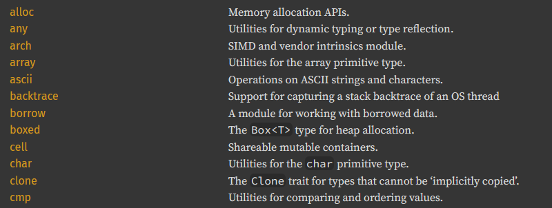
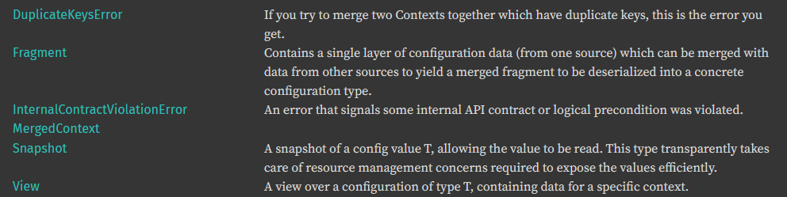
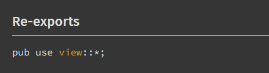


<!-- Copyright (c) Microsoft Corporation. Licensed under the MIT license. -->

# ドキュメント {#documentation}

<!-- Copyright (c) Microsoft Corporation. Licensed under the MIT license. -->

## 最初の文は1行、およそ15語 (M-FIRST-DOC-SENTENCE) { #M-FIRST-DOC-SENTENCE }

<why>API ドキュメントをざっと読みやすくするため。</why>

アイテムをドキュメント化すると、最初の文が「要約文」になり、抜き出されてモジュールの要約に表示されます。

```rust
/// これは要約文で、モジュールの要約に表示されます。
///
/// これはその他のドキュメントです。そのアイテムの詳細ページにだけ表示されます。
/// ここの文はいくら長くてもよく、何の問題も起きません。
fn some_item() { }
```

Rust の API ドキュメントは固定の最大幅で表示されるので、ほとんどの画面で見た目を整えるために超えるべきではない、
自然に好ましい文の長さがあります。

1行に収めれば、ドキュメントはざっと読みやすくなります。たとえば、標準ライブラリと比べてみてください。



そうしないと、_ウィドウ_ ができ、全体に読みにくい流れになってしまうかもしれません。



目安として、最初の文は **15語** を超えるべきではありません。
<!-- Copyright (c) Microsoft Corporation. Licensed under the MIT license. -->

## 包括的なモジュールのドキュメントがある (M-MODULE-DOCS) { #M-MODULE-DOCS }

<why>API ドキュメント内を簡単に移動できるようにするため。</why>

ライブラリの公開モジュールには、必ず `//!` によるモジュールのドキュメントがなければならず、その最初の文は [M-DOC-FIRST-SENTENCE] に従わなければなりません。

```rust,edition2021,ignore
pub mod ffi {
    //! FFI の抽象化を含みます。

    pub struct String {};
}
```

モジュールのドキュメントの残りの部分は包括的であるべきです。つまり、含まれるアイテムに関する最も重要な技術的側面を扱うべきです。これには次のものが含まれます。

- モジュールが何を含むか
- いつ使うべきか、場合によってはいつ使うべきでないか
- 例
- サブシステムの仕様（例: `std::fmt` は [そのフォーマット言語についても説明しています](https://doc.rust-lang.org/stable/std/fmt/index.html#formatting-parameters)）
- 観察できる副作用。それについて何らかの保証がある場合は、その保証も含む
- 関連する実装の詳細。例: 使っているシステム API

 優れた例には次のものがあります。

- [`std::fmt`](https://doc.rust-lang.org/stable/std/fmt/index.html)
- [`std::pin`](https://doc.rust-lang.org/stable/std/pin/index.html)
- [`std::option`](https://doc.rust-lang.org/stable/std/option/index.html)

これは、すべてのモジュールがこれらの項目をすべて含むべきだという意味ではありません。しかし、含まれる型どうしの相互作用について何か言うべきことがあるなら、
それを書くのにふさわしい場所はモジュールのドキュメントです。

[M-DOC-FIRST-SENTENCE]: ./#M-DOC-FIRST-SENTENCE
<!-- Copyright (c) Microsoft Corporation. Licensed under the MIT license. -->

## ドキュメントには標準的なセクションがある (M-CANONICAL-DOCS) { #M-CANONICAL-DOCS }

<why>確立された Rust のドキュメントの慣習に従うため。</why>

ライブラリの公開アイテムには、標準的なドキュメントのセクションがなければなりません。要約文は常に必要です。詳しい説明と例は
強く推奨されます。その他のセクションは、該当する場合に必要です。

```rust
/// 15語未満の要約文。
///
/// 自由な形式の詳しい説明。
///
/// # Examples
/// API の使い方をこのように示す1つ以上の例。
///
/// # Errors
/// 関数が `Result` を返すなら、既知のエラー条件を列挙する
///
/// # Panics
/// 関数がパニックしうるなら、それがいつ起きうるかを列挙する
///
/// # Safety
/// 関数が `unsafe` であるか、その他の形で UB を引き起こしうるなら、
/// 呼び出し側が守らなければならないすべての条件をこのセクションに列挙しなければならない。
///
/// # Abort
/// 関数がプロセスをアボートしうるなら、それがいつ起きうるかを列挙する。
pub fn foo() {}
```

他の言語とは違い、パラメータの表を作るべきではありません。代わりに、パラメータの使い方は普通の文章で説明します。つまり、次のようにはせず、

```rust,ignore
/// ファイルをコピーします。
///
/// # Parameters
/// - src: コピー元。
/// - dst: コピー先。
fn copy(src: File, dst: File) {}
```

代わりにこうします。

```rust,ignore
/// ファイルを `src` から `dst` にコピーします。
fn copy(src: File, dst: File) {}
```

### 関連資料 {#related-reading}

- 関数のドキュメントには、エラー、パニック、安全性に関する考慮事項を含める（[C-FAILURE](https://rust-lang.github.io/api-guidelines/documentation.html#c-failure)）
<!-- Copyright (c) Microsoft Corporation. Licensed under the MIT license. -->

## `pub use` のアイテムには `#[doc(inline)]` を付ける (M-DOC-INLINE) { #M-DOC-INLINE }

<why>再エクスポートしたアイテムが兄弟のアイテムと自然になじむようにするため。</why>

`pub use foo::Foo` や `pub use foo::*` でクレートのアイテムを公開で再エクスポートすると、それらは中身の見えない再エクスポートのブロックに表示されます。多くの場合、これは
読み手の役に立ちません。



代わりに、`use` している場所で `#[doc(inline)]` を付けて、自然にインライン化されるようにすべきです。

```rust,edition2021,ignore
# pub(crate) mod foo { pub struct Foo; }
#[doc(inline)]
pub use foo::*;

// または

#[doc(inline)]
pub use foo::Foo;
```


これは `std` やサードパーティの型には当てはまりません。それらは外部のものだとはっきりわかるように、常にインライン化せずに再エクスポートすべきです。

> ### <alert></alert> それでもグロブでのエクスポートは避ける {#still-avoid-glob-exports}
>
> 上の `#[doc(inline)]` の技は、[M-NO-GLOB-REEXPORTS] を変えるものではありません。一般に、アイテムをワイルドカードで再エクスポートすべきではありません。

[M-NO-GLOB-REEXPORTS]: ../libs/resilience/#M-NO-GLOB-REEXPORTS

